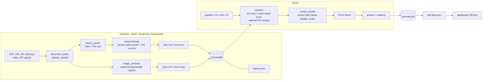

# Multimodal RAG over "Attention Is All You Need"

A retrieval-augmented generation system built from scratch. It parses the NeurIPS 2017
Transformer paper with a **layout-aware parser** that recovers the table of contents from
typography. It indexes text, ToC sections, figures and tables with **Jina CLIP v1** in
**ChromaDB**, and answers questions with **Phi-3-Vision**. Retrieved figures and tables are
passed to Phi-3-V as real pixels, and answers cite their evidence by tag and page.

Around the dependency-restricted core there is an optional service layer:
- a **FastAPI** service;
- a **Streamlit** UI;
- decoupled **batch, streaming and incremental ingestion**;
- **telemetry** (latency, tokens, quality);
- **drift detection** and an **MLflow**-backed monitoring dashboard.

| Component | Choice |
|---|---|
| Generation | `microsoft/Phi-3-vision-128k-instruct` (revision `ed2772f`) |
| Multimodal embeddings | `jinaai/jina-clip-v1` (revision `ceb3e44`), 768-d shared text/image space |
| Vector store | ChromaDB 1.5.9, persistent, cosine space |
| PDF / images | PyMuPDF (`fitz`) layout extraction, Pillow |
| Framework | PyTorch 2.5.1, Transformers 4.45.2, NumPy |
| Service layer (optional) | FastAPI, Uvicorn, Streamlit, MLflow |

## Where things are

| What | Location |
|---|---|
| **The paper (source data)** | [data/raw/attention_is_all_you_need.pdf](data/raw/attention_is_all_you_need.pdf). Downloaded from the NeurIPS URL on first run (11 pages, SHA-256 `d87d482d…`) and reused afterwards. |
| Extracted figures and tables | [data/processed/visuals/](data/processed/visuals/) (Figures 1–2, Tables 1–3 as PNG) |
| Vector index and registry | [storage/chroma/](storage/chroma/), [storage/registry.json](storage/registry.json) |
| Telemetry and MLflow stores | `storage/telemetry.db`, `storage/mlflow.db` |
| Solution notebook (executed) | [notebooks/multimodal_rag_solution.ipynb](notebooks/multimodal_rag_solution.ipynb), generated from [notebooks/build_notebook.py](notebooks/build_notebook.py) |
| Core source (allow-list compliant) | [src/](src/) |
| Service layer | [services/](services/): `api.py`, `ui.py`, `dashboard.py`, `tracking.py` |
| Tests | [tests/](tests/) |
| Evaluation set (labels verified against the PDF) | [data/sample_queries.json](data/sample_queries.json) |
| Evaluation pipeline | [src/evaluation.py](src/evaluation.py), `python -m src.cli evaluate` |
| Evaluation report and raw results | [docs/evaluation_report.md](docs/evaluation_report.md), [artifacts/evaluation/](artifacts/evaluation/) (one folder per run) |
| Sample outputs | [examples/example_outputs.md](examples/example_outputs.md) |
| Design, ingestion and monitoring docs | [docs/design.md](docs/design.md), [docs/ingestion.md](docs/ingestion.md), [docs/monitoring.md](docs/monitoring.md) |
| Original assignment | [Copy_of_Open_Insights_DS_Gen_AI_Task.ipynb](Copy_of_Open_Insights_DS_Gen_AI_Task.ipynb) (unchanged) |

---

## 1. Quick start

```bash
# Environment (Python 3.11; conda was used because python3.12-venv is not installed here)
conda create -y -p ./.venv python=3.11          # or: python3.11 -m venv .venv
.venv/bin/pip install torch==2.5.1 torchvision==0.20.1 --index-url https://download.pytorch.org/whl/cpu
.venv/bin/pip install -r requirements.txt               # core (assignment allow-list + model runtimes)
.venv/bin/pip install -r requirements-services.txt      # optional: API, UI, dashboard, MLflow
.venv/bin/pip install -r requirements-dev.txt           # optional: execute the notebook

# Build the index (downloads the PDF and Jina CLIP on first run; about 21 s on CPU afterwards)
.venv/bin/python -m src.cli index

# Ask (downloads Phi-3-V, about 8.3 GB, on first run; 1-4 min per answer on CPU)
.venv/bin/python -m src.cli ask "Which optimizer and learning rate schedule were used?"
.venv/bin/python -m src.cli chat                       # many questions, models stay loaded

# Services
.venv/bin/uvicorn services.api:app --port 8010                       # API, OpenAPI docs at http://localhost:8010/docs
.venv/bin/streamlit run services/ui.py --server.port 8501            # UI (talks to the API)
.venv/bin/streamlit run services/dashboard.py --server.port 8502     # monitoring dashboard
.venv/bin/mlflow ui --backend-store-uri sqlite:///storage/mlflow.db --port 5000

# Tests and evaluation
.venv/bin/python -m unittest discover -s tests -t .
RUN_MODEL_TESTS=1 .venv/bin/python -m unittest tests.test_smoke_models      # real models
.venv/bin/python -m src.cli evaluate --retrieval-only                        # about 1 min
.venv/bin/python -m src.cli evaluate                                         # + generation, about 45 min on CPU
.venv/bin/python -m services.tracking log-eval artifacts/evaluation          # record the run in MLflow
```

## 2. Architecture



| Module | Responsibility |
|---|---|
| `src/config.py` | typed, validated settings; index fingerprint |
| `src/document_loader.py` | atomic download with bounded retries; PDF validation; SHA-256 identity |
| `src/layout_parser.py` | **layout-aware parsing**: block roles from font size, weight, position and math fonts; ToC tree; footer, page-number and footnote handling |
| `src/text_extractor.py`, `src/preprocessing.py` | basic (regex) parser kept for comparison; normalisation; section-bounded chunk packing |
| `src/image_extractor.py` | embedded-raster validation; one rendered region per figure/table caption |
| `src/embedding_service.py` | Jina CLIP loaded once; OOM-adaptive batching; checks on vectors |
| `src/vector_store.py` | Chroma wrapper: validated upserts, filtered queries, deletes |
| `src/ingestion/` | registry, pure document processor, ingestion service (single/batch/sync/remove/rebuild), streaming queue and inbox watcher |
| `src/indexer.py` | `index` command for the configured paper (wrapper over ingestion) |
| `src/retriever.py` | text top-k; fused visual scoring with a gate; optional STAIR-style ToC routing; document scoping |
| `src/context_builder.py` | merges and deduplicates evidence, applies budgets, labels evidence with section paths, attaches image pixels |
| `src/generator.py` | Phi-3-V prompt and generation; token-limit check; citation parsing |
| `src/pipeline.py` | orchestration, context shrink-and-retry, telemetry recording |
| `src/telemetry.py`, `src/drift.py` | per-query telemetry (SQLite); PSI, KS and embedding drift |
| `src/evaluation.py`, `src/cli.py` | metrics and reports; command line |
| `services/api.py` | FastAPI: query, retrieve, ingestion jobs, documents, visuals, metrics, drift |
| `services/ui.py` | Streamlit UI: ask, retrieval explorer, documents and ingestion, system status |
| `services/dashboard.py` | Streamlit monitoring: latency and tokens over time, drift, MLflow evaluation history |
| `services/tracking.py` | MLflow logging of evaluation runs and telemetry windows |

## 3. Layout-aware parsing (hallucination reduction)

The first parser extracted plain text blocks and found headings with regular expressions.
Inspecting its chunks showed two context errors that encourage unsupported answers:
- the venue footer ("31st Conference on Neural Information Processing Systems…") was merged into the Introduction;
- footnote 4 (why dot products grow with d_k) was spliced into the Multi-Head Attention text.

Chunks also carried only their leaf heading, with no sense of where they sit in the paper.

Following **STAIR** (Kumar et al., *STructure Aware Information Retriever*, arXiv:2609.03874),
which shows that a document's table of contents is a better retrieval unit than
length-based chunks and that exposing the ToC reduces hallucination, the layout parser:

* derives the **ToC from typography**, because the PDF has no outline. Body size is the
  most common font size (10 pt). Headings are short bold blocks, numbered or named, at
  12 pt (level 1) or 10 pt bold (deeper levels). Level comes from the numbering depth. For
  this paper it recovers all 23 headings across 3 levels exactly.
* assigns every block a **role**: title, front matter, heading, paragraph, equation (math
  fonts CMMI/CMSY/CMR), caption, table, footnote (small font, lower page, marker),
  page number, or running header/footer (margin band, repeated or small).
* builds chunks that stay inside one ToC section and carry the **full section path**, for
  example `3 Model Architecture > 3.2 Attention > 3.2.1 Scaled Dot-Product Attention`.
  Equations stay with their sentence; captions, tables and footnotes become their own
  units; page furniture is dropped.
* adds one **ToC section record** per section (path plus opening text) to the index, the
  structural retrieval unit for optional routing.
* shows the section path as the **evidence label** in the prompt, so the model sees where
  each passage sits in the paper.

**Measured effect** (same 18 questions; see the evaluation report):
- retrieval precision@5 rises from 0.577 to 0.600, with MRR essentially unchanged (0.931 to 0.927);
- correct visuals in the prompt rise from 6/8 to 7/8;
- answer-level results are in the table below.

**Zero-shot ToC routing** (pick the top-2 sections, then chunks inside them) **lowered MRR
from 0.927 to 0.858**, because broad questions lost their best chunks to section-local
ones. It is implemented and evaluated but **off by default**. STAIR's gains come from
fine-tuning an LLM on the ToC, which this project does not do.

## 4. Results (measured on CPU, 18 questions)

**Retrieval** (final configuration: layout parser, fused visual score with a 0.40 gate):

| Hit@5 | Precision@5 | Recall@5 | MRR | Correct visual in prompt | Irrelevant images attached | Retrieval latency |
|---|---|---|---|---|---|---|
| 1.00 | 0.600 | 0.971 | 0.927 | 7 / 8 | 0 / 17 | about 0.06 s |

**Generation, evolution across four recorded runs** (all logged in MLflow):

| Metric | Run 1 (baseline) | Run 2 | Run 3 (prompt v3) | **Run 4 (final: layout parser)** |
|---|---|---|---|---|
| Mean keyword coverage | 0.77 | 0.64 | 0.86 | **0.89** |
| Answers citing a relevant page (of 17) | 11 | 8 | 12 | **12** |
| Invalid citation tags | 0 | 0 | 0 | 0 |
| Correct refuse/answer decisions (of 18) | 17 | 13 | 16 | 16 |
| Mean input / output tokens | 1177 / 66 | 1191 / 67 | 1193 / 112 | 1256 / 114 |
| Warm latency, mean / max (s) | 139 / 235 | 139 / 249 | 160 / 261 | 164 / 308 |

**Manual review of run 4:**
- 14 of 17 answerable questions correct and 1 partially correct (an unsupported claim
  about the decoder);
- 1 incorrect: the model misread the operation order in Figure 2;
- 1 false refusal (retrieval miss);
- the out-of-scope question was correctly refused.

The full report, with per-question answers, the A/B prompt test and the failure analysis,
is in [docs/evaluation_report.md](docs/evaluation_report.md).

## 5. Ingestion: batch, streaming, incremental

Details are in [docs/ingestion.md](docs/ingestion.md).

```bash
python -m src.cli ingest file paper.pdf            # one document; skipped if its content hash is already indexed
python -m src.cli ingest batch a.pdf b.pdf c.pdf   # a failing document is recorded; the batch continues
python -m src.cli ingest sync papers/ --prune      # incremental mirror of a directory
python -m src.cli ingest watch --poll 5            # streaming: drop PDFs into data/inbox
python -m src.cli ingest remove <doc_id>
python -m src.cli ingest rebuild                   # after changing the model, parser, chunking or image settings
python -m src.cli ingest status
```

The API does the same through a background worker: `POST /ingest/upload`,
`POST /ingest/batch`, `GET /ingest/jobs/{id}` and `DELETE /documents/{doc_id}`.

- **Unchanged content** is detected by hash, so nothing is recomputed.
- **Updated sources** are ingested first and the old version is deleted afterwards, so
  queries never see a gap.
- **Crashed ingestions** are purged and redone on the next run.
- A **writer lock** keeps a single writer process at a time.

## 6. API and UI

| Endpoint | Purpose |
|---|---|
| `GET /health` | status, model load state, generation busy flag, queue length |
| `POST /query` | `{question, mode?, generate?, structure_routing?, doc_ids?}` returns the full structured answer; with `generate: false` it returns retrieval only |
| `POST /retrieve` | ranked text chunks, visuals (with score components), routed sections |
| `GET /visuals/{visual_id}` | PNG of a retrieved figure or table |
| `GET /documents`, `GET /index/status` | registry and collection state |
| `POST /ingest/upload`, `POST /ingest/batch`, `GET /ingest/jobs[/{id}]`, `DELETE /documents/{id}` | ingestion jobs |
| `GET /metrics/summary`, `GET /metrics/queries`, `GET /monitoring/drift` | telemetry and drift |

On CPU, generation requests take 1–4 minutes. They are serialised behind a lock, and
health and status endpoints stay responsive meanwhile.

The Streamlit UI (`services/ui.py`) has four tabs: **Ask** (answer, latency and token
metrics, cited evidence with figure images), **Retrieval explorer** (scores, routed
sections, visuals above and below the threshold), **Documents** (registry, upload,
directory sync, job status) and **System**. It talks only to the API (`RAG_API_URL`).

## 7. Monitoring, latency, tokens and drift

Details are in [docs/monitoring.md](docs/monitoring.md).

* Every query (CLI, API, notebook, evaluation) is recorded in `storage/telemetry.db`:
  latency per stage, exact input and output tokens, top similarities, images used,
  abstention, citations, errors, config hash, prompt version and the query embedding.
* **Drift** is measured against the evaluation run (the reference window):
  - query-topic drift (embedding centroid distance and out-of-domain share);
  - retrieval drift (PSI and KS on the top similarity);
  - latency and token drift;
  - abstention and image-rate changes.
* The **dashboard** (`services/dashboard.py`) shows health metrics, latency and token time
  series, the drift table, MLflow evaluation history and recent queries.
* **MLflow**: `python -m services.tracking log-eval <dir>` records each evaluation (params,
  per-variant retrieval metrics, generation metrics, raw reports). `log-telemetry` records
  live-traffic aggregates and drift statistics; schedule it for a time series.
* CLI: `python -m src.cli monitor summary|drift [--hours N]`.

## 8. Dependency restrictions

The assignment allows `torch, chromadb, numpy, io, fitz, requests, PIL, transformers`.

* **`src/` (the assignment solution)** imports only those packages plus the standard
  library (logging, json, sqlite3, threading and so on). The notebook checks this with an
  AST scan of `src/`.
* `torchvision`, `timm`, `einops` and `accelerate` are installed only because the
  **mandated models' remote code** needs them; `src/` never imports them.
* **`services/`** (FastAPI, Streamlit, MLflow) is an optional layer that was requested in
  addition to the assignment. It is outside the allow-list on purpose, lives in its own
  package with its own requirements file, and the core runs, tests and evaluates without
  it. `tests/test_api.py` skips itself when FastAPI is not installed.

## 9. Key design decisions

* **Chunking (900 characters, 150 overlap):** whole paragraphs inside one ToC section;
  oversized paragraphs are split at sentence boundaries; overlap is whole trailing
  sentences, never across sections.
* **Visuals:** each caption anchors one rendered region at 200 dpi. Figure 2's two raster
  fragments and its panel titles become one image; the vector-drawn tables become images.
* **Cosine similarity:** Jina CLIP is trained contrastively with cosine, and its outputs
  are L2-normalised and checked.
* **Fused visual score with a 0.40 gate:** the mean of query-to-pixels and
  query-to-caption cosine. It removes all irrelevant image attachments (11 to 0) while
  keeping the correct ones. Each image costs about 757 tokens, roughly 75 s on CPU.
* **Context:** at most 3,600 characters of text and one image (`num_crops=4`). Phi-3-V
  prefill runs at about 10 tokens/s on this CPU.
* **Prompt:** evidence first, then the question, then the rules. The wording was chosen by
  measurement across three runs and an A/B test (see the evaluation report).
* **Index identity:** content hash per document plus an index fingerprint; incompatible
  changes require an explicit rebuild.

## 10. Configuration reference (`config/config.json`)

| Key | Default | Purpose |
|---|---|---|
| `document.source_url` / `local_path` | NeurIPS PDF / `data/raw/attention_is_all_you_need.pdf` | paper download and local copy |
| `document.download_timeout_s` / `download_max_retries` / `max_download_bytes` | 60 / 3 / 50 MB | download safety |
| `chunking.parser` | `layout` | `layout` (typography-aware, ToC paths) or `basic` (regex) |
| `chunking.chunk_size_chars` / `chunk_overlap_chars` / `min_chunk_chars` | 900 / 150 / 80 | chunk packing |
| `chunking.exclude_references` | true | skip the bibliography |
| `images.render_dpi` / `min_image_side_px` / `max_image_side_px` / `extract_tables` | 200 / 64 / 2048 / true | visual extraction |
| `embedding.model_id` / `revision` / `batch_size` / `max_text_tokens` / `device` | jina-clip-v1 / `ceb3e44…` / 16 / 512 / auto | embeddings |
| `vector_store.persist_dir` / `collection_name` / `registry_path` / `inbox_dir` | `storage/chroma` / `attention_paper_mm` / `storage/registry.json` / `data/inbox` | storage and ingestion |
| `retrieval.mode` / `top_k_text` / `top_k_image` | multimodal / 5 / 2 | retrieval |
| `retrieval.visual_scoring` / `min_visual_score` | fused / 0.40 | visual ranking and gate |
| `retrieval.structure_routing` / `top_k_sections` / `routed_text_slots` | false / 2 / 3 | STAIR-style ToC routing (off: it lowered MRR) |
| `context.max_context_chars` / `max_images` | 3600 / 1 | prompt budget |
| `generation.model_id` / `revision` / `dtype` / `num_crops` | Phi-3-V / `ed2772f…` / bfloat16 / 4 | generator |
| `generation.max_new_tokens` / `max_input_tokens` / `do_sample` / `attn_implementation` | 200 / 4096 / false / eager | decoding |
| `monitoring.telemetry_path` / `record_queries` | `storage/telemetry.db` / true | telemetry |
| `monitoring.mlflow_tracking_uri` / `mlflow_experiment` | `sqlite:///storage/mlflow.db` / `multimodal-rag` | MLflow |
| `logging.level` / `log_file` / `max_bytes` / `backup_count` | INFO / `logs/rag.log` / 5 MB / 3 | logging |

All values are validated at start-up, and every invalid key is reported at once. Device
`auto` picks CUDA if available; an explicit `cuda` without a GPU is an error, not a silent
fallback.

## 11. Tested environment and resources

* Linux, Python 3.11.18, Intel i7-1185G7 (4 cores, AVX-512, no native bf16), 31 GB RAM
  (about 10 GB free), **no GPU**. CUDA paths exist in the code but **were not verified**.
* Disk: Phi-3-V about 8.3 GB; Jina CLIP snapshot about 3.8 GB; index, registry and
  telemetry under 10 MB.
* RAM: Phi-3-V alone peaks at about 8.8 GB RSS; the full evaluation process peaks at
  about 14–15 GB RSS. Plan for 16 GB or more.

## 12. Troubleshooting

| Symptom | Fix |
|---|---|
| `IndexCompatibilityError … --rebuild` | the model, parser, chunking or image settings changed; run `python -m src.cli index --rebuild` |
| `Another ingestion process holds storage/ingest.lock` | one writer at a time: stop the API worker or the CLI watcher. A lock older than 6 h is removed automatically |
| `AttributeError … seen_tokens / get_max_length` | keep `transformers==4.45.2` (required by the Phi-3-V remote code) |
| `ModuleNotFoundError: timm / einops / torchvision` | install `requirements.txt` (model runtimes) |
| `shape mismatch [757, 3072] … [1514, 3072]` | a literal `<|image_1|>` appeared twice in a prompt; fixed and covered by a regression test |
| UI shows "API unreachable" | start `uvicorn services.api:app` and check `RAG_API_URL` |
| Each answer takes 1–4 minutes | expected on CPU; lower `num_crops` or `max_context_chars`, or use a GPU |
| Jina code "new version downloaded" warning | set `HF_HUB_OFFLINE=1` after the first run to freeze the cached remote code |

## 13. Known limitations

* Phi-3-V (4.2B, greedy decoding) is sensitive to prompt wording. It sometimes copies
  evidence verbatim, cites loosely, or refuses when the evidence is only partial.
  Citations are parsed and checked, not enforced.
* The evaluation set has 18 questions with no held-out split, and the visual threshold and
  prompt choice were selected on it.
* Layout heuristics are tuned to single-column academic PDFs. Two-column layouts or
  outline-less documents with unusual typography may need the `basic` parser or extra
  rules. Footnotes are attached to the section where they appear on the page, not where
  their marker is.
* There is no OCR (not in the allow-list), so scanned pages contribute only images.
* Chroma runs embedded in a single process; for multi-node scaling, switch to
  client/server Chroma and a message broker (see `docs/ingestion.md`).
* `jina-clip-v1` loads its modelling code without a pinnable revision; use the HF cache
  with `HF_HUB_OFFLINE=1` for reproducibility.
