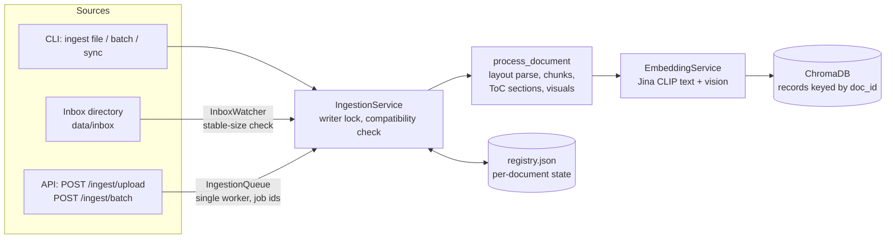

# Ingestion design: batch, streaming, incremental

Ingestion is decoupled from querying. It runs in a separate process (CLI, inbox watcher)
or behind the API's background worker, and it touches only three things: the embedding
service, the ChromaDB collection and the **document registry**.

## Components

| Component | File | Responsibility |
|---|---|---|
| `Registry` | `src/ingestion/registry.py` | per-document state (hash, source, local path, status, counts, timings, error) plus the collection fingerprint; atomic JSON writes |
| `process_document` | `src/ingestion/processor.py` | pure function: validated PDF to text chunks, ToC section records and visuals, with deterministic IDs |
| `IngestionService` | `src/ingestion/service.py` | single, batch, sync, remove and rebuild; incremental rules; verification; writer lock |
| `IngestionQueue` | `src/ingestion/streaming.py` | thread-safe FIFO with one background worker (used by the API) |
| `InboxWatcher` | `src/ingestion/streaming.py` | polls a directory; ingests files once their size is stable; moves them to `processed/` or `failed/` |

## Modes

| Mode | Command / endpoint | Behaviour |
|---|---|---|
| Single | `python -m src.cli ingest file paper.pdf [--source ID]` | ingest one PDF; skipped if unchanged |
| Batch | `python -m src.cli ingest batch a.pdf b.pdf …` / `POST /ingest/batch {"paths": [...]}` | each document independently; a failure is recorded and the batch continues |
| Incremental sync | `python -m src.cli ingest sync DIR [--prune]` / `POST /ingest/batch {"directory": DIR, "prune": true}` | new and changed files are ingested, unchanged ones skipped, deleted files removed with `--prune` |
| Streaming (files) | `python -m src.cli ingest watch [--inbox DIR] [--poll 5]` | drop PDFs into the inbox; each is ingested exactly once |
| Streaming (API) | `POST /ingest/upload` (multipart PDF), then `GET /ingest/jobs/{id}` | returns a job id immediately; a background worker processes the job |
| Remove | `python -m src.cli ingest remove DOC_ID` / `DELETE /documents/{id}` | deletes the document's records and marks it `removed` |
| Rebuild | `python -m src.cli ingest rebuild` / `index --rebuild` | drops the collection and re-processes every registered document from its local copy |
| Status | `python -m src.cli ingest status` / `GET /index/status` | registry and collection counts |

## Incremental rules

* **Identity:** `doc_id` is the first 12 hex characters of the PDF's SHA-256, and every
  record ID is prefixed with it. Identical bytes mean the same document, whatever the
  filename.
* **Unchanged:** the same `doc_id` is already `indexed` with the current fingerprint, so
  nothing is recomputed (no embedding calls).
* **Updated:** new bytes arrive for an existing *source* (same path, URL or upload name).
  The new version is ingested and verified **first**, and only then are the old version's
  records deleted and the old version marked `removed` ("superseded"). Queries never see a
  gap.
* **Crash safety:** a document is marked `ingesting` before any write. If the process dies,
  the next run finds it `ingesting`, purges its partial records and ingests it again. A
  partial document is never served as complete.
* **Failure:** a domain error (corrupt PDF, embedding failure, verification mismatch)
  purges that document's records and marks it `failed` with the error message. Other
  documents are unaffected.
* **Verification:** after each upsert, the number of records stored for the `doc_id` must
  equal the number produced. Otherwise the document fails.

## Compatibility and rebuilds

The **index fingerprint** covers the embedding model and revision, the parser
(`layout`/`basic`), the chunking settings and the image settings. It is stored in the
collection metadata and in the registry. Vectors or chunks built under a different
fingerprint aren't comparable, so ingestion refuses
(`IndexCompatibilityError … --rebuild`) until `rebuild` re-processes every registered
document. Retrieval, context and generation settings are not part of the fingerprint;
they can change without re-indexing.

## Concurrency

ChromaDB's embedded `PersistentClient` is designed for a single process. Ingestion therefore uses:

* **in-process:** one worker thread (`IngestionQueue`), so jobs run strictly one after another;
* **across processes:** an `O_EXCL` lock file (`storage/ingest.lock`, treated as stale
  after 6 h). A second writer, for example the CLI watcher while the API worker holds the
  lock, fails fast with a clear message instead of corrupting the store.

To scale beyond one machine, move Chroma to client/server mode (`chromadb.HttpClient`)
and put the queue in a broker. The `IngestionService` interface stays the same.

## Metadata per record

| Field | text | section | image |
|---|---|---|---|
| `modality` | `text` | `section` | `image` |
| `doc_id`, `source`, `page`, `page_start`, `page_end` | yes | yes | yes |
| `section`, `section_path`, `section_key`, `chunk_id`, `ordinal`, `figure_ref` | yes | `section_path`, `section_key`, `level` | – |
| `visual_id`, `kind`, `label`, `image_path`, `width`, `height`, `bbox` | – | – | yes |
