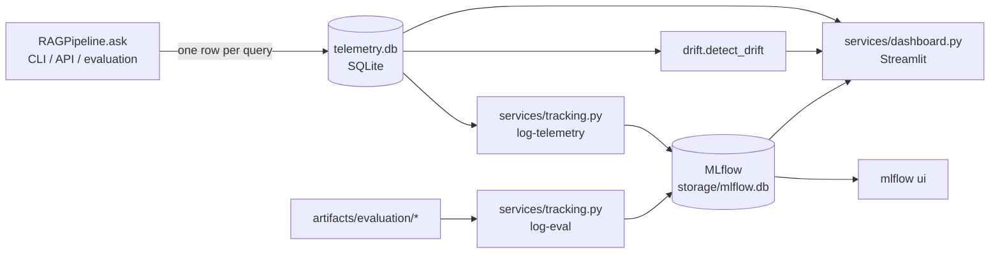

# Monitoring: latency, token usage, quality and drift

## What is recorded (`src/telemetry.py`)

Every `RAGPipeline.ask` call writes one row, including failed calls (with the error class
and message). Telemetry write errors are logged and never interrupt answering.

| Group | Fields |
|---|---|
| Latency (s) | `latency_total`, `latency_retrieval` (query embedding + vector search), `latency_generation` |
| Tokens | `input_tokens` (exact Phi-3-V prompt length, image tokens included), `output_tokens` |
| Retrieval | `top_text_similarity`, `top_visual_score`, `n_text`, `n_images`, `mode` |
| Outcome | `insufficient` (abstained), `n_citations`, `n_invalid_citations`, `error`, `cold_start` |
| Provenance | `source` (`api` / `cli` / `evaluation`), `run_id`, `config_hash`, `prompt_version` |
| Drift input | `embedding`: the 768-d query vector (float32 blob) |

The store uses standard-library `sqlite3`, so the core stays within the dependency
allow-list. MLflow is used only in `services/`.

## Drift detection (`src/drift.py`)

The **reference window** is the queries logged by `python -m src.cli evaluate` (source
`evaluation`): known questions with measured quality. The **current window** is recent
live traffic (the last 200 queries, or a time window).

| Signal | Method | Levels |
|---|---|---|
| Query topic drift | Centroid cosine distance; **out-of-domain share** = fraction of current queries whose nearest reference query is less similar than the reference set's 5th-percentile nearest-neighbour similarity | stable < 0.2 ≤ moderate < 0.4 ≤ significant |
| Retrieval quality drift | PSI and two-sample KS test on `top_text_similarity` | PSI < 0.1 stable, 0.1–0.25 moderate, > 0.25 significant; downgraded one level if KS p ≥ 0.05 |
| Latency / token drift | PSI + KS on `latency_total`, `input_tokens`, `output_tokens` | same |
| Behaviour drift | change in abstention rate and image-attachment rate | \|Δ\| < 0.1 stable, < 0.25 moderate, else significant |

No result is reported below 10 queries in either window (`insufficient_data`), because
these tests have little statistical power on tiny samples.

**How to read it:**
* A rising out-of-domain share together with falling `top_text_similarity` means users are
  asking about content the index does not cover. Ingest more documents, or accept the
  higher abstention rate.
* Latency drift with unchanged token counts points to a hardware or load problem.
* Latency drift together with token drift points to longer contexts or more images (check
  `n_images`).

## Tools

| Tool | Command | Shows |
|---|---|---|
| CLI summary | `python -m src.cli monitor summary [--hours 24]` | latency p50/p95, token totals and means, rates |
| CLI drift | `python -m src.cli monitor drift [--hours 24]` | full drift report (JSON) |
| API | `GET /metrics/summary`, `GET /metrics/queries`, `GET /monitoring/drift` | same, over HTTP |
| Dashboard | `streamlit run services/dashboard.py --server.port 8502` | health metrics, latency and token time series, drift table, MLflow evaluation history, recent queries |
| MLflow: evaluations | `python -m services.tracking log-eval artifacts/evaluation/<run>` | one run per evaluation: retrieval metrics per variant, generation metrics, raw reports as artifacts |
| MLflow: monitoring | `python -m services.tracking log-telemetry --hours 24` (schedule hourly or daily) | live aggregates and every drift statistic as a time series, tagged `drift_status` |
| MLflow UI | `mlflow ui --backend-store-uri sqlite:///storage/mlflow.db --port 5000` | run comparison and metric plots |

## Alerting (recommended)

Schedule `log-telemetry` (cron or a systemd timer). In MLflow, or in any scheduler
reading `GET /monitoring/drift`, alert when `status == "significant"`, when
`latency_total_p95` exceeds its SLO, or when `error_rate > 0`.
